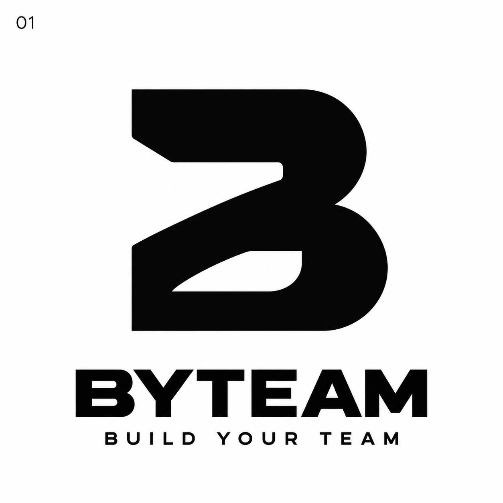
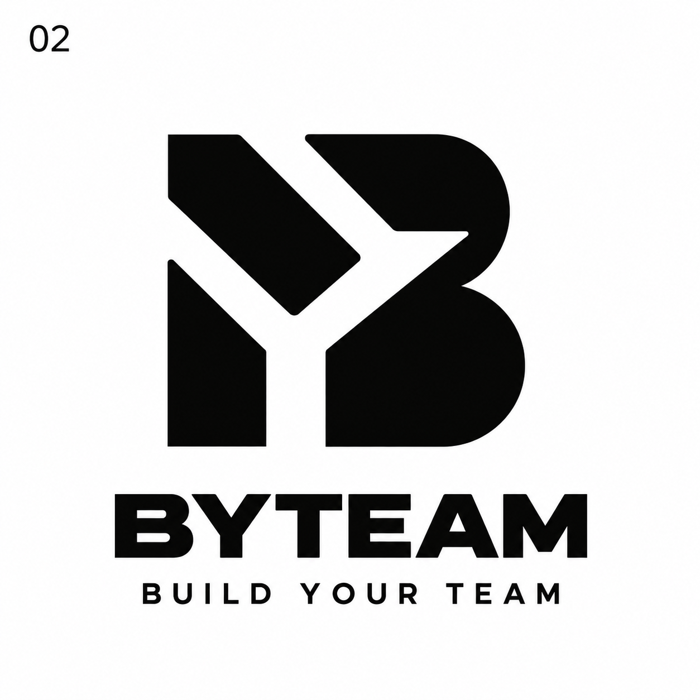
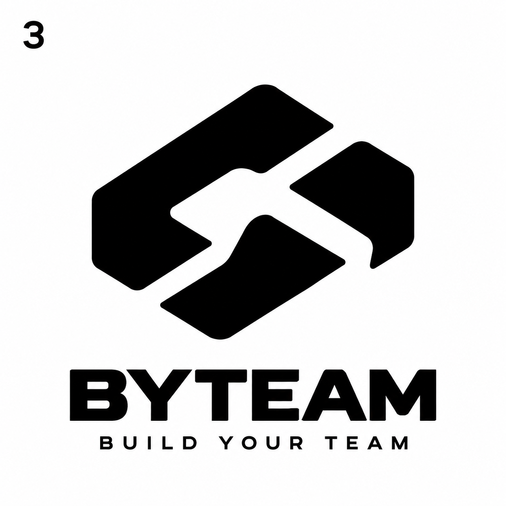
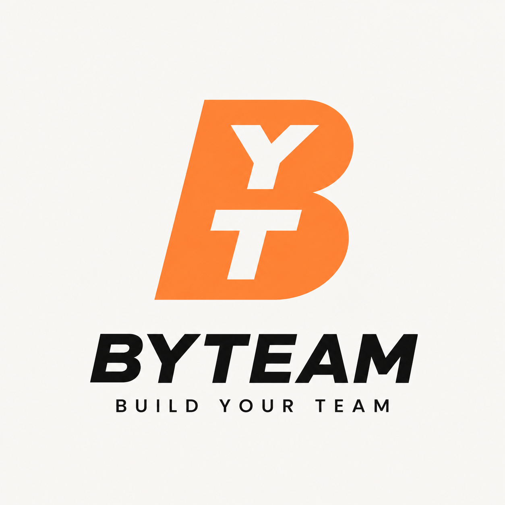

# BYTEAM — варианты логотипа

Текущая версия для сайта: **[наклонная B с Y сверху и T снизу](../../../public/brand/byteam-byt-italic.png)**. Уточнены просветы и баланс букв для компактного знака. Она используется в шапке, боковом меню и иконке вкладки. Ниже сохранены предыдущие эскизы.

Три концепции для обсуждения. Это растровые эскизы, а не готовые векторные логотипы. Изображения имеют непрозрачный белый фон. Проверка уникальности знаков и реальной читаемости в размере favicon ещё не выполнена.

## 01 — монограмма B

Самый прямой вариант: компактная стилизованная B.

[Открыть изображение отдельно](01-monogram-b.png)

## 02 — связь B / Y

Монограмма с сочетанием B и Y через свободное пространство. Предлагаемое направление для дальнейшей доработки.

[Открыть изображение отдельно](02-monogram-by.png)

## 03 — командный знак

Абстрактный знак взаимодействия двух геометрических форм.

[Открыть изображение отдельно](03-team-symbol.png)

После выбора направления нужны геометрическая доработка, подготовка SVG и проверки в реальных размерах и на сходство с другими брендами.

## 04 — наклонная B с Y и T

Новый эскиз на основе наклонной буквы B: Y размещена сверху, T — снизу. Оранжевый знак на светлом фоне. Это вариант для обсуждения; текущий логотип сайта не заменён.

[Открыть наклонный вариант отдельно](04-italic-byt.png)

